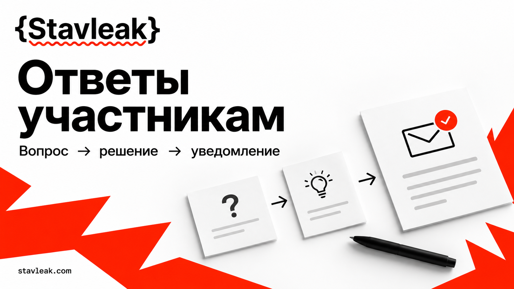

<p><a href="https://stavleak.com/ru"><picture><source media="(prefers-color-scheme: dark)" srcset="assets/stavleak-logo-dark.svg"></picture></a></p>

# Коммуникация с участниками хакатона



**Цель: устранить противоречивые ответы и довести каждое изменение правил до всей затронутой аудитории.** Комплект помогает дежурному найти действующее правило, передать вопрос человеку с полномочиями и проверить доставку объявления. Подходит для онлайн, очного и гибридного хакатона; для другого формата сначала замените роли и условия участия.

[Stavleak](https://stavleak.com/ru/) помогает организациям проводить события и открывает рабочую среду для их самостоятельного проведения. Здесь собраны редактируемые организационные материалы. Копия файлов становится рабочим комплектом после заполнения контактов, правил и каналов вашего события.

<!-- stavleak:application -->
## Рабочее приложение

В репозитории есть интерфейс на **Next.js** и сервер на **Rust**. Создавайте реальные записи через формы: сервер проверяет их и сохраняет в локальный файл. Начальное состояние пустое; учебные данные загружаются отдельной кнопкой с подтверждением.

Нужны Node.js 22+, pnpm 10.33.0 и установленный Rust 1.88+ с системным линкером. В Windows стандартному Rust MSVC нужны Visual Studio Build Tools с компонентом Desktop development with C++; в Linux — C/C++ toolchain.

```sh
pnpm install --frozen-lockfile
pnpm setup
pnpm dev
```

`pnpm setup` предложит задать пароль и создаст случайные серверные ключи в игнорируемом `.env.local`. Откройте **http://127.0.0.1:3005/ru** и войдите с выбранным паролем. Одновременно работает одно приложение на стандартных портах 3005 и 3006.

Данные сохраняются в `data/state.json`. Обновление устаревшей версии возвращает конфликт, а закрытые предметные записи защищены серверными правилами. Пароль, ключи и рабочие данные не входят в публичный репозиторий. [Возможности и сценарии](docs/application.md) · [Запуск, резервные копии и границы доступа](docs/local-operation.md).

Проверка: `pnpm check`; сборка интерфейса: `pnpm build`; рабочий запуск сборки: `pnpm start`. Приложение рассчитано на одну закрытую локальную рабочую среду организатора. Русский интерфейс находится по `/ru`; переводы на другие языки пока не созданы.

Шаблоны и примеры ниже дополняют приложение. CSV-файлы не импортируются и не синхронизируются автоматически: используйте их отдельно либо переносите нужные записи через формы.

## Какую проблему решаем

Дедлайн в чате расходится с расписанием. Волонтёр обещает исключение без полномочий. О переносе узнают активные читатели чата, а участник без доступа к нему продолжает работать по старым условиям. При смене дежурного теряется обещанное время ответа.

Рабочий порядок: вопрос → запись в журнале → решение уполномоченного владельца → новая версия источника и FAQ → одно объявление во все согласованные каналы → проверка всей аудитории → закрытие либо адресная эскалация. Напоминание о действующем правиле пропускает этап изменения версии.

## Быстрый старт за 15 минут

Время ниже — порядок настройки комплекта, а не обещание скорости ответа участникам.

| Минуты | Действие | Результат |
|---|---|---|
| 0–3 | Скопируйте [карту связи](templates/communication-map.md), назначьте дежурного, владельца правил и заместителя | У каждого канала и решения есть человек с полномочиями |
| 3–6 | Впишите ссылку на действующие правила, сохраните [снимок версии](templates/rules-version.md), заполните [FAQ](templates/faq.md) | Дедлайн, способ сдачи и помощь совпадают во всех материалах |
| 6–9 | Подготовьте [стартовое объявление](templates/announcement-start.md), выберите независимый резервный канал | Участник найдёт правила и помощь без личного знакомства с организатором |
| 9–12 | В приватной копии [проверки уведомления](templates/delivery-check.csv) перечислите всю затронутую аудиторию по участникам либо проверяемым группам | Видно, кому ещё нужно отправить сообщение и кто его не подтвердил |
| 12–15 | Проведите короткую [репетицию](examples/rehearsal.md): вопрос без решения и отказ основного канала | Дежурный знает следующего владельца и публикует точное время обновления |

Полная репетиция включает все проверки из файла; трёх минут хватает только на первый прогон. Перед реальным стартом уберите поля в квадратных скобках, проверьте ссылки с правами участника и согласуйте условия изменения правил.

## Что лежит в репозитории

| Материал | Для чего нужен |
|---|---|
| [Карта связи](templates/communication-map.md) | Официальный источник, резерв, роли, языки, время ответа и эскалация |
| [Журнал решений CSV](templates/decision-log.csv) | Владелец, дедлайн, следующий шаг, версия правил, аудитория и статус |
| [Снимок правил](templates/rules-version.md) | Старая и новая редакция, утверждение, время действия и последствия |
| [Единый FAQ](templates/faq.md) | Короткие проверенные ответы и отдельная формулировка «решение ожидается» |
| [Старт](templates/announcement-start.md), [изменение](templates/announcement-rule-change.md), [сбой](templates/announcement-incident.md), [дедлайн](templates/announcement-deadline.md) | Сообщение, после которого понятно, кому и что делать |
| [Проверка уведомления CSV](templates/delivery-check.csv) | Отправлено, доставлено, подтверждено, неизвестно; следующий способ связи |
| [Приватное обращение](templates/private-request.md) | Чувствительные обстоятельства, ограниченный доступ, обезличенный общий ответ |
| [Передача смены](templates/shift-handoff.md) | Открытые вопросы, обещанные обновления и принятие новым дежурным |
| [Учебное событие](examples/event.md) и [два случая](examples/cases.md) | Согласованные готовые записи, включая сбой канала и уведомление всех об изменении |
| [Пример журнала](examples/decision-log.csv), [проверки уведомления](examples/delivery-check.csv), [FAQ](examples/faq.md) | Примеры заполнения для одного вымышленного события |

## Порядок работы дежурного

1. **Ответ уже утверждён.** Найдите пункт FAQ и его версию; ответьте ссылкой и точным временем. Если два официальных источника расходятся, заведите решение и передайте владельцу правил. Не выбирайте удобную версию самостоятельно.
2. **Ответ не утверждён.** Создайте запись `awaiting_approval`, назначьте владельца и время следующего обновления. Ответьте: «Решение ожидается; пока действует версия [версия]. Следующее обновление [дата, время, зона]». Перенос срока, исключение или результат ещё не обещаны.
3. **Нужно изменить правило.** Владелец правил фиксирует старое и новое условие, причину, последствия для уже совершённых действий и полномочия утверждающего в снимке версии. Дежурный проверяет одинаковые даты и смысл во всех нужных языках. Только затем обновляет официальный источник и FAQ и отправляет одно объявление.
4. **Нужно уведомить всех.** Перед отправкой зафиксируйте состав аудитории из регистрационного списка; включите одиночных участников, команды без активного капитана и затронутых сотрудников. Одновременно используйте все обязательные каналы из карты. Для недоставленного или неподтверждённого сообщения назначьте адресное действие и срок проверки. Не публикуйте адреса получателей в открытой рассылке.
5. **Доставка неполная.** Отправка не доказывает доставку, а доставка не доказывает прочтение. Сохраните неизвестный статус. Руководитель решает, как дать недоступной группе сопоставимое время и возможность выполнить действие; решение публикуют для всех затронутых. Ужесточение правила не вступает в силу до проверки уведомления и условий равного доступа.
6. **Смена закончилась.** Передайте открытые записи, текущую версию, точные обещанные обновления и недоставленные сообщения. Новый дежурный явно принимает смену. До принятия действует прежний ответственный.

В журнале одно решение занимает одну строку с текущим статусом. Хронологию утверждений и смены статуса сохраняйте в связанном рабочем документе; старые версии правил и отменённые решения не удаляйте. `approved` ещё не означает, что участники уведомлены. `closed` ставят после выполненного следующего шага, согласованных условий доступа и проверки аудитории.

Статусы решений: `draft` — запись подготовлена; `awaiting_approval` — ждёт уполномоченного решения; `approved` — решение утверждено; `publishing` — источник и объявления обновляются; `notified` — проверена вся аудитория; `closed` — следующий шаг выполнен и открытых вопросов по решению нет; `rejected` — запрос отклонён, причина и ответ сохранены.

В проверке уведомления используйте `unknown`, `sent`, `delivered`, `partial`, `confirmed`. `sent` означает только отправку, `delivered` — техническое свидетельство доставки, `confirmed` — явное подтверждение всех адресатов строки. При частичном подтверждении ставьте `partial` и точное число. Сохраняйте новую строку каждой проверки; текущий итог берите из последней строки каждой пары `decision_id + audience_unit`, чтобы повторно не считать получателей.

## Как проверить, что проблема решена

Это критерии приёмки вашего процесса, а не статистика использования Stavleak:

- Два дежурных независимо называют один дедлайн, одну версию правил и один маршрут помощи.
- У каждого открытого решения есть владелец, следующий шаг и время следующего обновления; неутверждённое решение не звучит как обещание.
- В критическом объявлении совпадают старое и новое условие, дата, зона, аудитория, время действия и ссылка на источник.
- Состав аудитории сверили с регистрациями. У каждой строки проверки есть свидетельство уведомления либо открытая эскалация; закрытое решение не скрывает группу с неизвестным статусом.
- Участник без основного канала получает обязательные сведения через проверенный резерв. Участник, читающий только текст, находит те же правила, что и зритель слайдов.
- После передачи смены новый дежурный находит незакрытый вопрос и публикует обещанное обновление вовремя.

## Доступность, время и приватность

Публикуйте обязательные сведения обычным текстом, а не только картинкой, голосовым сообщением или трансляцией. Ссылка должна называться по назначению; проверьте чтение с телефона, увеличение текста и доступ без аккаунта организатора. Для очного формата подготовьте стойку помощи и печатный текст. Объявите, как запросить нужный формат приватно.

Пишите абсолютную дату, время, UTC-смещение и согласованную зону, например `2026-11-07 18:00 UTC+05:00 (Asia/Qyzylorda)` и, если нужно, `13:00 UTC`. В примерах это фиксированные учебные значения; для своего события проверьте смещение на его дату. Все переводы одной версии проверяет человек, понимающий оба языка. Если перевод не готов, отметьте этот факт и организуйте помощь для соответствующей аудитории; не объявляйте её уведомлённой автоматически.

Рабочий журнал получателей, контакты, подтверждения доставки и приватные обращения храните в доступной только команде события копии. В GitHub оставляйте пустые шаблоны и вымышленные примеры. В публичном FAQ сохраняйте применимое правило без имён, личных обстоятельств и вложений. В карте связи назначьте срок пересмотра хранения и человека, который удалит больше не нужные персональные записи.

## Границы комплекта

Шаблоны помогают организовать ручной процесс. Они не отправляют рассылки, не проверяют полномочия пользователей и не подтверждают доставку технически. Тексты условий, контакты, сроки ответа и резервные способы сдачи должен утвердить организатор. Примеры вымышлены; реальные события и результаты здесь не описаны.

Материалы открыты для улучшений: [правила участия](CONTRIBUTING.md). Узнать о проведении события и рабочей среде: [stavleak.com/ru](https://stavleak.com/ru/).

<!-- stavleak:brand-footer -->
[Stavleak](https://stavleak.com/ru) · [Материалы организатора](https://org.stavleak.com/ru#toolkit)

<!-- stavleak:related-kits -->
## Другие задачи организатора

- [Очередь менторов](https://github.com/Stavleak/hackathon-mentor-dispatch-kit)
- [Смены волонтёров](https://github.com/Stavleak/hackathon-volunteer-shift-kit)
- [Репетиция события](https://github.com/Stavleak/hackathon-event-rehearsal-kit)
- [Из демо в пилот](https://github.com/Stavleak/hackathon-pilot-handover-kit)
